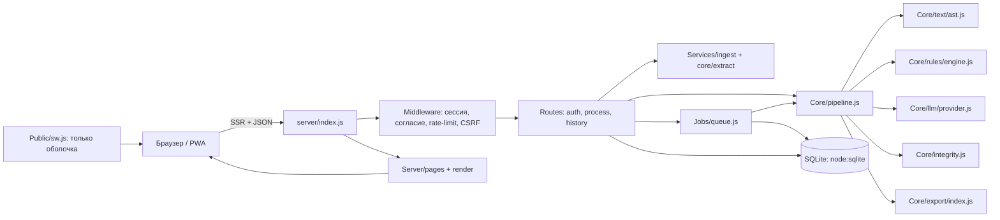
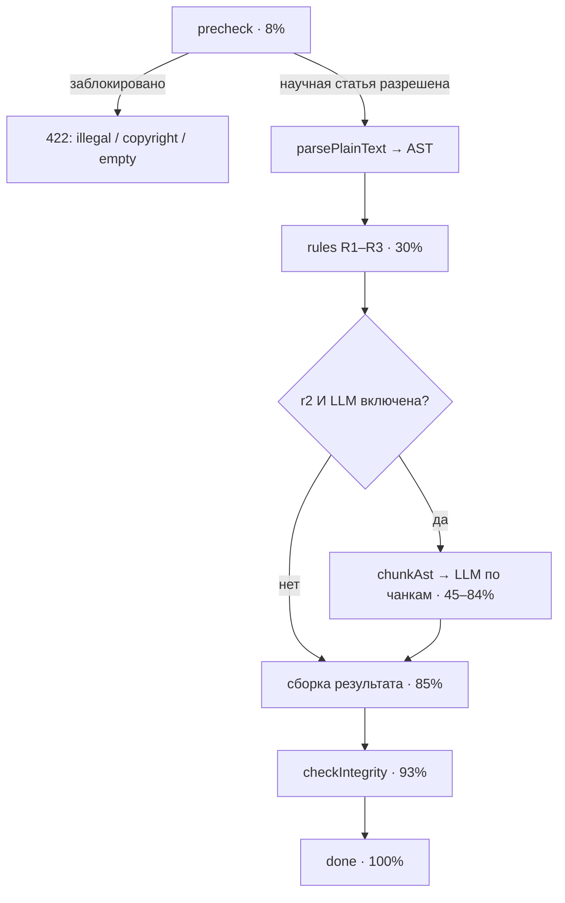

# Архитектура «Челотекст»

> Описано по факту состояния кода на 25 ноября 2026. Источники: `server/**`, `package.json`, `.env.example`,
> [TZ.md](./TZ.md), [PROMPT.md](./PROMPT.md), [HANDOFF.md](./HANDOFF.md).
> Обоснование выбранных технологий — в [decisions.md](./decisions.md).

---

## 1. Общая картина

Это **один Express-процесс** с серверным рендерингом страниц и JSON API, встроенной SQLite и in-process очередью. Никаких Python, Docker, PostgreSQL, Redis, Celery или BullMQ в рабочей конфигурации нет.

| Слой | Файлы | Ответственность |
|---|---|---|
| Транспорт | `server/index.js`, `server/render.js`, `server/pages/index.js` | Express, статика с версионированием ассетов, SSR-страницы, `/healthz`, 404/500 без стектрейсов. |
| Middleware / безопасность | `server/middleware/index.js`, `server/lib/*` | Подписанные cookie-сессии, **gate согласия (403)**, rate-limit по IP/пользователю, CSRF по Origin, CSP и другие заголовки. |
| API | `server/routes/auth.js`, `process.js`, `history.js` | Авторизация/согласие, обработка и задачи, ревизии, экспорт, история, настройки, удаление данных. |
| Прикладные сервисы | `server/services/users.js`, `documents.js`, `ingest.js`, `server/jobs/queue.js` | Пользователи и согласия, документы/задачи/ревизии/экспорты, приём материалов, очередь. |
| Ядро обработки | `server/core/**` | AST, правила, LLM-адаптеры, предпроверка, контроль целостности, извлечение, экспорт, diff. |
| Данные | `server/db/index.js` | `DatabaseSync` из `node:sqlite`, WAL, внешние ключи, миграции. |
| Клиент | `public/**` | SSR-страницы + модульный JS, PWA manifest и service worker, локальные шрифты и иконки. |

Страницы: `/`, `/start`, `/login`, `/register`, `/app`, `/history`, `/jobs/:id`, `/settings`, `/legal/privacy`, `/legal/terms`, `/legal/personal-data`.

`/healthz` возвращает `{ ok, uptime, queue: { running, queued, concurrency }, llm: providerInfo(), version: '1.0.0' }`. В `llm` — только имя провайдера, модель, версия промпта, флаги `enabled`/`configured` и, для GigaChat, источник ключа; сами секреты не отдаются.

---

## 2. Единый AST

`server/core/text/ast.js` — центральный тип данных. Документ: `{ version: 1, blocks: [...] }`.

Типы блоков: `heading`, `paragraph`, `list`, `table`, `quote`, `footnotes`, `divider`.

- `parsePlainText()` понимает Markdown-подобную разметку: `#` заголовки, `-`/`1.` списки, `| … |` таблицы, `> ` цитаты, `---` разделители; остальное собирается в абзацы.
- `astToPlainText()`, `astToMarkdown()`, `astToHtml()` — три проекции одного дерева.
- `astFromEditedText()` превращает отредактированный пользователем текст обратно в AST.
- Ревизии пользователя и результат задачи сохраняются как `ast_json` / `result_ast_json` в SQLite.
- `server/core/diff.js` строит построчный diff для вида «Было / Стало».

Благодаря AST правила R1–R3, извлечение структуры PDF, экспорт и правки работают с одними и теми же блоками, а не с «просто строкой».

---

## 3. Поток обработки

`runPipeline()` в `server/core/pipeline.js` — единственный оркестратор. Каждый этап сообщает прогресс через `onProgress` и проверяет `isCancelled()`.

| Этап | Что происходит |
|---|---|
| `precheck` | Пусто/короче 80 знаков — отказ; маркеры незаконного контента — всегда блок; чужой авторский текст ≥ 1200 знаков — блок, если не научная статья (`isScientific()`: ≥3 маркера). Блокировка пишется в `precheck_log` **до** сохранения документа. |
| `rules` | `applyRules()` применяет R1/R2/R3 с учётом уровня 1–5: cleanup пробелов, capitalizeStart, разбивка абзацев, словари замен, читаемость. |
| `llm` | Только при включённом R2, `LLM_ENABLED=true` и доступном провайдере. Chunking по границам блоков (`LLM_CHUNK_CHARS=3000`) с перекрытием в 1 блок; таблицы и сноски после LLM возвращаются из оригинального AST (`mergePreserved`). Ошибка чанка не роняет задачу — чанк остаётся после правил, причина возвращается в `llm.fallbackReason` результата пайплайна. |
| `assemble` / `integrity` | Сборка текста из AST, сверка чисел, дат, URL, цитат и капитализаций: `checkIntegrity()` → `{ ok, score, missing, added, checked }`. Результат сохраняется в `jobs.integrity_json`. Функция `repairLosses()` есть в коде и покрыта тестами, но в основном пайплайне не вызывается. |
| `done` | Ответ клиенту/обновление задачи: текст, AST, статистика, readability до/после, данные о провайдере и `promptVersion`. |

Отмена проверяется и в пайплайне, и в очереди. Для async-задачи флаг `cancel_requested` в БД объединяется с `AbortController`, поэтому отмена останавливает и обработку, и извлечение/OCR.

---

## 4. Провайдеры LLM

`server/core/llm/provider.js` — заменяемый адаптер. Бизнес-логика зависит только от интерфейса `generate(text, { level, modes })`; выбор делается в `createProvider()` по `LLM_PROVIDER`.

| Провайдер | Статус | Транспорт |
|---|---|---|
| `rules` | **реализован, по умолчанию** | Возвращает текст как есть; всю работу делает движок правил. Сеть не используется. |
| `ollama` | реализован | `POST {LLM_BASE_URL}/api/chat`, self-host, модель по умолчанию `qwen2.5:7b-instruct`. |
| `openai` | реализован | `POST {LLM_BASE_URL}/v1/chat/completions`, `Authorization: Bearer …`. Через него работает ProxyAPI (`https://api.proxyapi.ru`, `LLM_MODEL=openai/gpt-5-mini`). |
| `gigachat` | **реализован** | `server/core/llm/gigachat.js`: ключ → OAuth-токен на 30 минут → `POST https://api.giga.chat/v1/chat/completions`. |

Общее для сетевых провайдеров: таймаут `LLM_TIMEOUT_MS=45000`, retry с экспоненциальным backoff (`LLM_MAX_RETRIES=2`), circuit breaker (3 ошибки → пауза 60 с), очистка обёрток ответа модели и graceful fallback на результат правил с причиной в `llm.fallbackReason` ответа пайплайна. Промпты версионируются (`PROMPT_VERSION = 2026-11-24.1`) и их версия пишется в задачу для воспроизводимости.

### GigaChat: детали адаптера

- Ключ авторизации задаётся как `GIGACHAT_CRED` либо парой `GIGACHAT_CLIENT_ID` + `GIGACHAT_CLIENT_SECRET`; из пары сервер сам собирает Basic-значение `base64(client_id:client_secret)`.
- OAuth: `POST https://ngw.devices.sberbank.ru:9443/api/v2/oauth` с `RqUID`, `scope=GIGACHAT_API_PERS` и Basic-заголовком. Токен кэшируется и обновляется за 60 секунд до истечения (`GIGACHAT_TOKEN_SKEW_MS`); при `401` от модели делается однократное принудительное обновление.
- Один поток физлиц: вызовы `generate()` сериализуются в рамках процесса цепочкой promise. При нескольких задачах рекомендуется `JOB_CONCURRENCY=1`.
- TLS: корневой PEM НУЦ Минцифры берётся из `certs/russian_trusted_root_ca.crt` и/или `GIGACHAT_CA_FILE`, добавляется к `tls.rootCertificates`; проверка сертификата не отключается. Скачивание — `npm run certs`.
- Заголовок `User-Agent` обязателен (`GIGACHAT_USER_AGENT`, по умолчанию `chelotext/1.0`). Повторы при `429/502/503/504`. Секреты вырезаются из сообщений об ошибках (`redact`), `/healthz` показывает только источник ключа.

---

## 5. Синхронный и асинхронный пути

Пороги в `server/config.js`: `SYNC_MAX_CHARS=12000`, `SYNC_MAX_MS=55000` (значение объявлено, но переключение сейчас идёт **по длине текста**), `JOB_CONCURRENCY=2`, `OCR_CONCURRENCY=1` (в конфиге объявлен, но текущий воркер отдельно этот лимит не применяет).

| Ситуация | Путь |
|---|---|
| `/api/process` с текстом ≤ 12000 знаков | Синхронно: `runPipeline()` внутри запроса, ответ 200 с результатом, `mode: 'sync'`. |
| `/api/process` длиннее порога | `createJob({ mode: 'async' })` → `enqueueJob()` → ответ **202** с публичным ID задачи. |
| Файл/ссылка с текстом длиннее порога | Аналогично; метаданные и OCR-флаги сохраняются в `documents`. |
| **Скан-PDF** (`meta.fromOcr`) | Всегда асинхронно (`needsAsync()`), независимо от объёма. |

Очередь `server/jobs/queue.js`:

- массив задач в памяти, приоритет `extract` = 0, `process` = 1;
- до `JOB_CONCURRENCY` параллельных воркеров;
- статусы `queued → processing → done | failed | cancelled`, этапы пишутся в `jobs.stage` и `jobs.progress`;
- отмена: `POST /api/jobs/:id/cancel` ставит флаг и вызывает runtime-отмену через `AbortController`;
- при старте сервера `recoverStuckJobs()` помечает застрявшие `processing` как `failed` с кодом `interrupted`;
- синхронный путь использует `isCancelled: () => false` — отмена применима к задачам очереди.

Ограничение: очередь не персистентна — задачи в памяти теряются при перезапуске, распределённый вызов и внешний брокер не предусмотрены.

---

## 6. Извлечение (ingest)

| Источник | Реализация |
|---|---|
| Paste | `fromPaste()` → normalizeText → AST; до 100 000 знаков, валидация и на клиенте, и на сервере. |
| URL | `core/extract/url.js`: `cheerio`, выбор самого содержательного контейнера, заголовки/списки/таблицы в Markdown-подобный текст; защита от SSRF (только http/https, запрет локальных и приватных адресов, DNS-проверка, таймаут 20 с). EPUB не поддерживается. |
| TXT / MD | Читается как UTF-8, normalizeText → AST. |
| DOCX | `mammoth` → HTML → AST; заголовки, списки и таблицы сохраняются структурой. |
| PDF с текстовым слоем | `pdfjs-dist/legacy` + `useSystemFonts`; постранично, `MIN_TEXT_PER_PAGE=40` определяет кандидата на OCR. |
| Скан-PDF / смешанный | `core/extract/ocr.js`: страница рендерится в PNG через `@napi-rs/canvas`, затем `tesseract.js` с языками `rus+eng`; языковые данные копируются из `@tesseract.js-data/rus|eng` в `data/tessdata`. Средняя уверенность и флаг `ocrLowConfidence` попадают в мета. |

Сохранение структуры PDF (`core/extract/pdf.js`): таблицы → Markdown-таблицы, двухколоночная вёрстка склеивается в порядке чтения, повторяющиеся колонтитулы и номера страниц вырезаются, сноски собираются в блок `footnotes`, абзацы склеиваются между страницами. Лимиты: ≤ 50 страниц **и** ≤ 100 000 знаков; при нарушении — 413 с явным кодом ошибки. Результат OCR помечается `from_ocr=1`, в ответе/истории есть метка «из OCR» и предупреждение о возможных ошибках распознавания.

---

## 7. Экспорт и редактор

`server/core/export/index.js` — единый интерфейс `exportDocument(ast, format)`.

| Формат | Механизм |
|---|---|
| TXT | `astToPlainText()` |
| Markdown | `astToMarkdown()` (включая таблицы и сноски) |
| HTML | `astToHtml()` + встроенный шаблон с токенами из `design.md` |
| PDF | `pdfkit`, A4, локальный TTF из `public/fonts` с фолбэком на системные шрифты; таблицы рисуются отдельно |
| DOCX | `docx`: заголовки, абзацы, списки, таблицы, сноски |

Экспорт доступен по `GET /api/jobs/:id/export/:format` только для задач в статусе `done`; каждый вызов пишется в `exports`. Копирование в буфер — `GET /api/jobs/:id/text` (чистый plain text). Правки пользователя сохраняются ревизиями `POST /api/jobs/:id/revisions` с проверкой `baseRevision` (409 `conflict`); каждая ревизия обновляет `jobs.result_text` и AST.

---

## 8. База данных

`server/db/index.js`: `DatabaseSync` из `node:sqlite`, PRAGMA `journal_mode=WAL`, `foreign_keys=ON`, `busy_timeout=5000`. Миграции версионируются таблицей `schema_migrations` (сейчас одна миграция, version 1 `initial`). Обёртка `q` даёт `all/get/run/exec/tx` (`BEGIN IMMEDIATE` для транзакций).

| Таблица | Назначение и ключевые поля |
|---|---|
| `users` | email, `password_hash`, `consent_status`, `consent_at`, `consent_policy_version`, `consent_ip`, `retention_days`. |
| `sessions` | `id`, `user_id` (CASCADE), `expires_at`, `ip`, `user_agent`. |
| `consents` | История согласий: `action` (`grant`/`revoke`), `policy_version`, `at`, `ip`, `user_agent`. |
| `documents` | `source` (`paste`/`url`/`file`), `original_text`, `ast_json`, `char_count`, `page_count`, `from_ocr`, `ocr_confidence`, `deleted_at`. |
| `jobs` | `public_id`, `document_id`, `options_json`, `mode`, `status`, `stage`, `progress`, `result_text`, `result_ast_json`, `error_code`, `integrity_json`, `llm_provider`, `llm_model`, `prompt_version`, `cancel_requested`, временные метки. |
| `edits` | Ревизии результата: `job_id`, `revision` (уникально в паре), `text`, `ast_json`. |
| `exports` | Журнал скачиваний: `job_id`, `format`, `bytes`, `created_at`. |
| `precheck_log` | **Журнал заблокированных попыток** (в ТЗ — «блокировки»): `reason_code`, `excerpt` (до 300 знаков), `char_count`. Отдельной таблицы `blocked_attempts` в коде нет. |
| `schema_migrations` | `version`, `name`, `applied_at`. |

Внешние ключи каскадно удаляют документы, задачи, ревизии и экспорты при удалении пользователя. Отзыв согласия вызывает `deleteUserData()` — фактическое удаление данных. Фоновая чистка раз в 6 часов (`pruneSessions`, `purgeExpired`) и ручной `POST /api/settings/purge` учитывают `RETENTION_DAYS` / `users.retention_days`.

Пароли хешируются `node:crypto` (scrypt), cookie подписываются HMAC; секрет либо из `SESSION_SECRET`, либо генерируется в `data/.session-secret`.

---

## 9. Клиент и PWA

- SSR-страницы отдаются с `Cache-Control: no-store`; статика — с `maxAge`, версия ассета добавляется как `?v=<hash>` (`server/render.js`).
- `public/js/app.js` **сразу** вызывает `navigator.serviceWorker.register('/sw.js')` (на https и localhost/127.0.0.1); обёртка в `window.load` была убрана: модульный скрипт мог выполниться после `load`, и регистрация терялась.
- `public/sw.js`: precache оболочки (стили, JS, иконки, манифест, шрифты), cache-first для `/styles|js|fonts|icons`, network-first для навигаций, офлайн-страница «Нет сети». `/api/*` **никогда** не кэшируется. Офлайн-обработка текста не реализована и не планируется в MVP.

---

## 10. Инструменты и известные разрывы с ТЗ/планом

- `npm run lint` и `npm run certs` имеют рабочие скрипты в `scripts/`; `npm test` — 126 зелёных тестов, включая изоляцию секретов GigaChat; eval-выборка — 18/18.
- `SYNC_MAX_MS` есть в конфиге, но переключение в очередь идёт только по числу знаков.
- `OCR_CONCURRENCY` объявлен в конфиге, но отдельный лимит для OCR в очереди не применяется.
- EPUB и офлайн-обработка не реализованы.
- Очередь не переживает перезапуск процесса; внешний брокер не используется.
- `repairLosses()` написан и протестирован, но не встроен в основной пайплайн.
